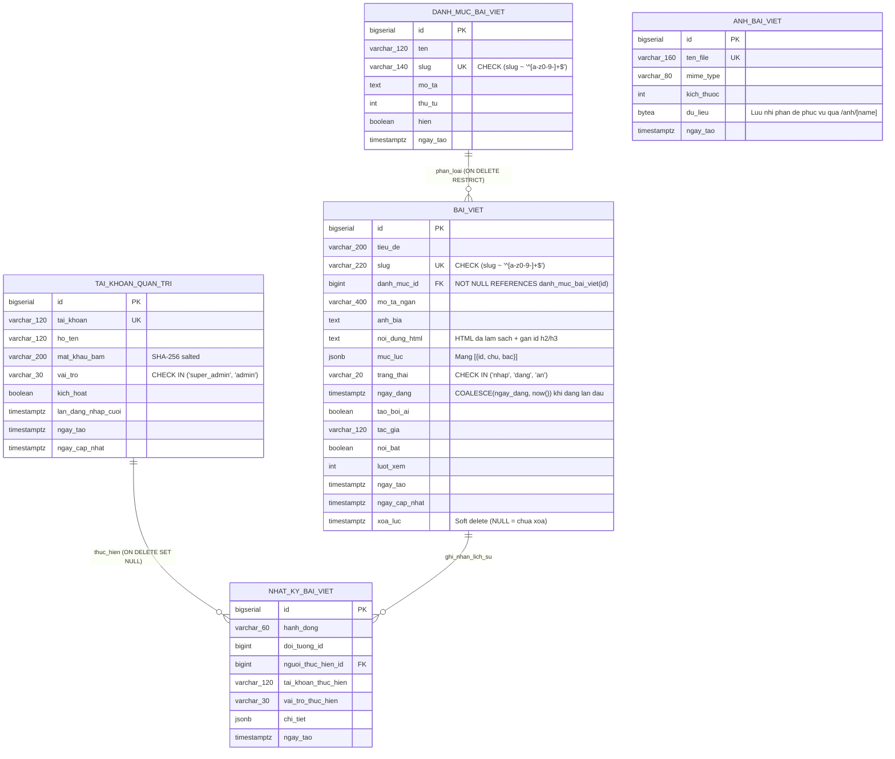

# Thiết kế Cơ sở Dữ liệu — Nếp Hiên (`nephien.com`)

**Nguồn chân lý là `src/lib/db.ts` và `src/lib/db-schema.sql` chạy trên Neon Serverless PostgreSQL.** Tài liệu này giải thích kiến trúc dữ liệu, quy ước đặt tên, sơ đồ thực thể và các ràng buộc bảo toàn dữ liệu ở tầng CSDL.

---

## 1. Chiến lược CSDL

* **Hệ quản trị:** **Neon PostgreSQL 17** (Serverless Postgres, vùng `ap-southeast-1` Singapore, kết nối qua connection pooler với `sslmode=require`).
* **Truy cập dữ liệu:** Driver `postgres` (`postgres.js`) kết nối trực tiếp qua biến môi trường `DATABASE_URL` phía Server (Next.js App Router Route Handlers & Server Components), sử dụng parameterized queries chống SQL Injection 100%.
* **Khóa chính:** `bigserial` (`bigint` tự tăng) cho toàn bộ bảng nghiệp vụ.
* **Đặt tên:** **Bảng và cột tiếng Việt không dấu, `snake_case`** (`danh_muc_bai_viet`, `bai_viet`, `anh_bai_viet`, `nhat_ky_bai_viet`) — đồng nhất với chuẩn thiết kế của hệ sinh thái Nếp Hiên (`C:\nephien\nephien`), giúp đối chiếu trực tiếp giữa tài liệu PRD/Spec và câu lệnh SQL.

---

## 2. Sơ đồ thực thể (ERD)



---

## 3. Chi tiết các bảng

### 3.1. Bảng `danh_muc_bai_viet`
Lưu trữ các chuyên mục bài viết (ví dụ: *Cẩm nang nội thất*, *Phong cách thiết kế*, *Kiến thức vật liệu*, *Chính sách & Bảo hành*).

* **Ràng buộc khóa ngoại `ON DELETE RESTRICT` từ `bai_viet.danh_muc_id`:** Không cho phép xóa danh mục đang còn bài viết (kể cả bài nháp hoặc bài trong thùng rác), tránh mất phân loại bài viết trong im lặng.
* **Cờ `hien` (`boolean`):** Khi `hien = false`, toàn bộ bài viết thuộc danh mục này tự động ẩn khỏi danh sách công khai `/bai-viet`, trang đọc bài `/bai-viet/[slug]` và `/sitemap.xml` mà không cần sửa trạng thái từng bài.

### 3.2. Bảng `bai_viet`
Bảng trung tâm lưu trữ bài viết kiến trúc & nội thất của Nếp Hiên.

* **Bảo toàn `ngay_dang`:** Ràng buộc `chk_bv_dang_co_ngay CHECK (trang_thai <> 'dang' OR ngay_dang IS NOT NULL)` đảm bảo không bao giờ tồn tại bài viết ở trạng thái `'dang'` mà thiếu ngày xuất bản. Khi sửa bài đã đăng hoặc ẩn rồi đăng lại, hệ thống dùng `COALESCE(ngay_dang, now())` để giữ nguyên ngày đăng lần đầu.
* **Tách truy vấn danh sách và chi tiết:** Các truy vấn danh sách (cả Admin và Storefront) **không bao giờ `SELECT noi_dung_html`** để giữ kích thước gói tin nhỏ và tốc độ phản hồi nhanh qua kết nối Serverless.
* **Cột `muc_luc` (`jsonb`):** Được tính toán sẵn lúc lưu bài từ các thẻ `<h2>` và `<h3>` trong `noi_dung_html`, giúp giao diện đọc bài dựng thanh Mục lục neo trái ngay lập tức mà không cần parse lại DOM ở phía client.

### 3.3. Bảng `anh_bai_viet`
Lưu trữ ảnh tải lên từ trình soạn thảo quản trị (`bytea` + metadata) và phục vụ qua route `/anh/[name]` với header `Cache-Control: public, max-age=31536000, immutable`. Thiết kế lưu trữ trong Neon PostgreSQL giúp ảnh tải lên bền vững tuyệt đối trên môi trường serverless/container mà không bị mất khi redeploy.

### 3.4. Bảng `nhat_ky_bai_viet`
Lưu vết mọi thao tác quản trị (`bai_viet.tao`, `bai_viet.sua`, `bai_viet.doi_trang_thai`, `bai_viet.xoa`, `bai_viet.khoi_phuc`, `danh_muc_bai_viet.*`) phục vụ kiểm toán và tra cứu lịch sử biên tập.

---

## 4. Chiến lược đánh chỉ mục (Indexes)

1. **`idx_bv_cong_khai` (Partial Index):**
   ```sql
   CREATE INDEX idx_bv_cong_khai
     ON bai_viet (danh_muc_id, ngay_dang DESC)
     WHERE trang_thai = 'dang' AND xoa_luc IS NULL;
   ```
   Tối ưu hóa trực tiếp cho truy vấn phổ biến nhất trên mặt tiền `/bai-viet` và `/sitemap.xml`. Chỉ những bài đang hiển thị công khai mới nằm trong index.

2. **`idx_bv_quan_tri`:**
   ```sql
   CREATE INDEX idx_bv_quan_tri
     ON bai_viet (xoa_luc, trang_thai, ngay_cap_nhat DESC);
   ```
   Phục vụ trang `/admin/articles` khi lọc theo tab trạng thái (`Tất cả`, `Bản nháp`, `Đã đăng`, `Đang ẩn`, `Thùng rác`) và sắp xếp theo thời gian cập nhật.
