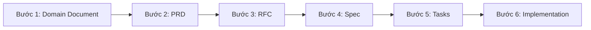

# Quy trình viết tài liệu theo từng bước (Step-by-Step Documentation Guide)

Tài liệu này hướng dẫn quy trình chuẩn từ lúc bắt đầu ý tưởng (Domain) cho đến khi ra danh sách công việc (Tasks) để code cho hệ thống **Nếp Hiên (`nephien.com`)**.

---

## Tổng quan luồng tài liệu

---

## Bước 1: Định nghĩa nghiệp vụ (Domain Document)

* **Mục đích**: Hiểu rõ bài toán kinh doanh, từ vựng chung (Ubiquitous Language) và quy tắc bất biến (Business Invariants).
* **Vị trí lưu**: `docs/specs/domains/{domain}-domain.md`
* **Nội dung chính**:
  * Phạm vi bài toán (In-scope / Out-of-scope).
  * Bảng thuật ngữ chuẩn (Ubiquitous Language).
  * Các quy tắc nghiệp vụ cốt lõi (`R1`, `R2`...).
  * Thực thể chính (Entities) và Vòng đời trạng thái (State Machine).

---

## Bước 2: Viết yêu cầu sản phẩm (PRD - Product Requirements Document)

* **Mục đích**: Xác định *Xây cái gì?* và *Tại sao xây?* dưới góc nhìn người dùng và kinh doanh.
* **Vị trí lưu**: `docs/specs/features/{nhom}/{feature}/{feature}-prd.md`
* **Nội dung chính**:
  * Bối cảnh & Mục tiêu (Goals / Non-goals).
  * Chân dung người dùng (Personas).
  * User Stories (`US-xx`) và Acceptance Criteria (`AC-xx` dạng Given / When / Then).
  * Ma trận phân quyền & ràng buộc phi chức năng (NFR).

---

## Bước 3: Đề xuất giải pháp kỹ thuật (RFC - Request for Comments)

* **Mục đích**: Giải quyết câu hỏi *Xây như thế nào ở mức kiến trúc?* và chốt các quyết định đánh đổi (Trade-offs).
* **Vị trí lưu**: `docs/specs/features/{nhom}/{feature}/{feature}-rfc.md`
* **Nội dung chính**:
  * Kiến trúc tổng thể & luồng dữ liệu.
  * Các phương án thay thế đã cân nhắc (Alternatives Considered) và lý do chọn.
  * Bảo mật (XSS sanitization, CSP, SQL parameter binding), hiệu năng và khả năng mở rộng.

---

## Bước 4: Đặc tả kỹ thuật chi tiết (Technical Specification - Spec)

* **Mục đích**: Bản thiết kế chi tiết đến mức Developer nhìn vào là code được ngay mà không cần đoán.
* **Vị trí lưu**: `docs/specs/features/{nhom}/{feature}/{feature}-spec.md`
* **Nội dung chính**:
  * Thiết kế Database chi tiết (DDL SQL, bảng, cột tiếng Việt không dấu `snake_case`, index, constraint).
  * Thiết kế API Endpoints (Path, Method, Request/Response JSON, HTTP Status Codes).
  * Chi tiết xử lý Backend (Sanitize HTML, rút mục lục H2/H3, sinh slug không trùng, nhật ký thao tác).
  * Chi tiết giao diện Frontend (Routes, Components, Soi SEO 12 tiêu chí, bản nháp cục bộ).

---

## Bước 5: Chia nhỏ công việc (Implementation Tasks)

* **Mục đích**: Bóc tách Spec thành các đầu việc конкрет có thể kiểm thử độc lập.
* **Vị trí lưu**: `docs/specs/features/{nhom}/{feature}/{feature}-tasks.md`
* **Nội dung chính**:
  * Danh sách các Task theo thứ tự phụ thuộc (DB → Backend Lib/API → Admin UI → Public UI → SEO/Sitemap → Playwright E2E).
  * Mỗi task gắn kèm mã `AC-xx` và điều kiện nghiệm thu rõ ràng.

---

## Bước 6: Thực thi & Kiểm thử tự động (Implementation & Verification)

* Thực thi code theo đúng `Spec` và `Tasks`.
* Chạy kiểm thử tự động E2E bằng Playwright để xác nhận toàn bộ `AC` hoạt động đúng trên trình duyệt thực tế.
