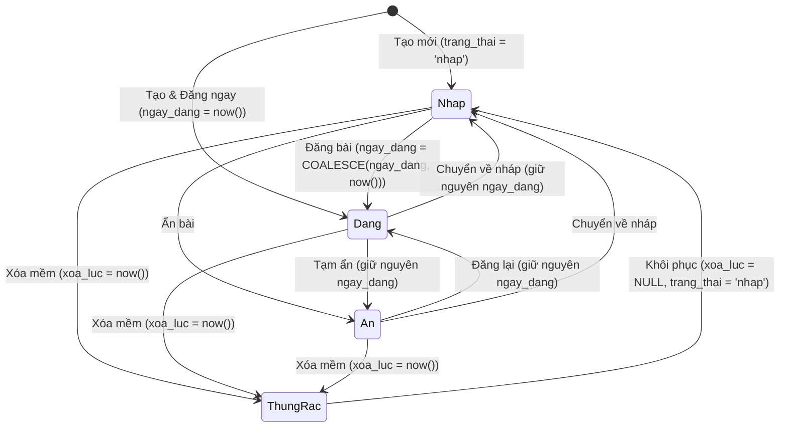

# Domain: Quản lý bài viết & Nội dung mặt tiền — Nếp Hiên (`nephien.com`)

> **Trạng thái**: Active
> **Cập nhật lần cuối**: 2026-10-19
> **Tài liệu liên quan**:
> - Thiết kế CSDL: [`docs/architecture/database-design.md`](../../architecture/database-design.md)
> - Bộ tài liệu tính năng: [`docs/specs/features/chung/bai-viet/`](../features/chung/bai-viet/)

---

## 1. Tổng quan Domain (Domain Overview)

Domain **Quản lý bài viết & Nội dung mặt tiền** phụ trách toàn bộ vòng đời xuất bản bài viết trên website thương hiệu kiến trúc & nội thất **Nếp Hiên (`nephien.com`)** — bao gồm cẩm nang thiết kế nội thất, triết lý phong cách sống Đông Dương & Đương đại, kiến thức vật liệu tự nhiên, câu chuyện công trình và các bài chính sách dịch vụ.

Domain giải quyết 4 bài toán cốt lõi:
1. **Biên tập & Quản trị tập trung (`/admin/articles`)**: Giúp đội ngũ nội dung Nếp Hiên tự chủ hoàn toàn việc viết bài mới, định dạng bố cục chuẩn tạp chí kiến trúc, tải ảnh lên Neon DB, quản lý danh mục, xuất bản/ẩn/xóa mềm mà không cần can thiệp mã nguồn.
2. **Bảo chứng chất lượng SEO ngay khi gõ (`SoiSeo`)**: Chấm điểm trực tiếp 12 tiêu chí On-Page SEO (từ khóa chính, mật độ từ khóa, độ dài tiêu đề/mô tả, cấu trúc H2/H3, alt ảnh, liên kết nội bộ) ngay trong trình soạn thảo.
3. **An toàn nội dung HTML (`lamSachHtml`)**: Làm sạch toàn bộ mã HTML trên máy chủ bằng cơ chế allowlist nghiêm ngặt và tự động gắn `id` cho các thẻ `<h2>`, `<h3>` để trích xuất mục lục (`muc_luc`).
4. **Trải nghiệm đọc chuẩn Quiet Luxury (`/bai-viet`, `/bai-viet/[slug]`)**: Hiển thị danh sách bài viết lọc theo danh mục, trang đọc bài có thanh mục lục neo trái (scroll-spy) & ngăn kéo di động, bài viết liên quan cùng danh mục, dữ liệu có cấu trúc JSON-LD (`Article`, `BreadcrumbList`) và `/sitemap.xml` tự động.

### Phạm vi (Scope)
* **Trong phạm vi (In-scope):**
  * Quản lý danh mục bài viết (`danh_muc_bai_viet`): Thêm, sửa, đổi thứ tự (`thu_tu`), bật/tắt hiển thị (`hien`), xóa có kiểm tra ràng buộc.
  * Quản lý bài viết (`bai_viet`): Tạo, sửa, đổi trạng thái (`nhap`, `dang`, `an`), đánh dấu bài nổi bật (`noi_bat`), xóa mềm vào thùng rác (`xoa_luc`), khôi phục từ thùng rác.
  * Trình soạn thảo giàu định dạng (Rich-text Editor), tải ảnh lên máy chủ lưu vào Neon PostgreSQL (`anh_bai_viet`) và phục vụ qua `/anh/[name]`.
  * Tự động lưu nháp cục bộ (`localStorage`) phòng mất điện/đóng tab và cảnh báo khi đổi `slug` của bài đã đăng.
  * Bảng kiểm tra chuẩn SEO thời gian thực (`SoiSeo`) với 12 tiêu chí có thể tùy chỉnh ngưỡng.
  * Mặt tiền công khai `/bai-viet`, `/bai-viet/[slug]`, tích hợp bài viết mới nhất trên Trang chủ và `/sitemap.xml`.
* **Ngoài phạm vi (Out-of-scope):**
  * Hệ thống bình luận công khai của độc giả.
  * Hệ thống đa ngôn ngữ cho từng bài viết.

---

## 2. Từ vựng chung (Ubiquitous Language)

| Thuật ngữ (Tiếng Việt) | Tên kỹ thuật (Code / DB) | Định nghĩa |
| :--- | :--- | :--- |
| **Danh mục bài viết** | `DanhMucBaiViet` / `danh_muc_bai_viet` | Nhóm phân loại bài viết theo chủ đề (Cẩm nang nội thất, Phong cách thiết kế, Kiến thức vật liệu...). Mỗi bài viết bắt buộc thuộc đúng 1 danh mục. |
| **Bài viết** | `BaiViet` / `bai_viet` | Đơn vị nội dung xuất bản gồm tiêu đề, đường dẫn tĩnh (`slug`), ảnh bìa, mô tả ngắn, nội dung HTML đã làm sạch và mục lục trích sẵn. |
| **Đường dẫn tĩnh** | `slug` | Chuỗi chữ thường ASCII không dấu nối bằng dấu gạch ngang (`^[a-z0-9-]+$`), duy nhất toàn bảng, dùng trên URL `/bai-viet/[slug]`. |
| **Mục lục tự động** | `MucLucMuc[]` / `muc_luc` | Mảng JSON `[{ id, chu, bac }]` trích xuất tự động từ các thẻ `<h2>` (`bac: 2`) và `<h3>` (`bac: 3`) trong nội dung bài viết khi lưu. |
| **Làm sạch HTML** | `lamSachHtml()` | Hàm máy chủ loại bỏ toàn bộ thẻ/thuộc tính nguy hiểm (XSS) theo danh sách cho phép (allowlist) trước khi ghi vào CSDL. |
| **Bản nháp** | `trang_thai = 'nhap'` | Bài viết đang biên tập, chưa công khai trên mặt tiền và không có trong `/sitemap.xml`. |
| **Đã đăng** | `trang_thai = 'dang'` | Bài viết đã xuất bản công khai, luôn có `ngay_dang IS NOT NULL`. |
| **Đang ẩn** | `trang_thai = 'an'` | Bài viết tạm gỡ khỏi mặt tiền công khai nhưng vẫn giữ nguyên `ngay_dang` lịch sử. |
| **Xóa mềm (Thùng rác)** | `xoa_luc` | Thời điểm bài viết bị đưa vào thùng rác (`xoa_luc IS NOT NULL`). Bài trong thùng rác không hiển thị công khai nhưng có thể khôi phục về trạng thái `'nhap'`. |
| **Soi SEO** | `SoiSeo` / `chamSeo()` | Bộ chấm điểm 12 tiêu chí SEO On-Page chạy tức thời trên trình duyệt khi biên tập viên gõ nội dung. |

---

## 3. Quy tắc nghiệp vụ cốt lõi (Business Rules & Invariants)

* **[R1] Điều kiện hiển thị công khai kép**: Một bài viết chỉ được phép xuất hiện ở `/bai-viet`, `/bai-viet/[slug]`, trang chủ và `/sitemap.xml` khi và chỉ khi thỏa mãn đồng thời 3 điều kiện:
  1. `bai_viet.trang_thai = 'dang'`
  2. `bai_viet.xoa_luc IS NULL`
  3. `danh_muc_bai_viet.hien = true`
* **[R2] Đồng nhất 404 không rò rỉ**: Mọi truy cập công khai vào `/bai-viet/[slug]` của bài không tồn tại, đang ở trạng thái `'nhap'`/`'an'`, đã xóa mềm (`xoa_luc IS NOT NULL`), hoặc thuộc danh mục đang ẩn (`hien = false`) đều trả về đúng `404 Not Found` mà không tiết lộ lý do ẩn.
* **[R3] Slug chuẩn hóa và duy nhất**: `slug` của danh mục và bài viết bắt buộc khớp biểu thức chính quy `^[a-z0-9-]+$`. Nếu người dùng không nhập `slug`, hệ thống tự chuyển tiếng Việt có dấu sang ASCII không dấu từ tiêu đề và tự động nối hậu tố `-2`, `-3`... nếu trùng.
* **[R4] Làm sạch HTML và trích mục lục tại thời điểm lưu**: `noi_dung_html` luôn phải đi qua `lamSachHtml()` rồi tới `rutMucLuc()` trên máy chủ trước khi `INSERT`/`UPDATE`. Cấm dùng `<h1>` trong thân bài (vì tiêu đề bài viết đã là `<h1>` duy nhất của trang).
* **[R5] Bảo toàn ngày đăng lần đầu (`ngay_dang`)**: Khi bài viết chuyển sang trạng thái `'dang'` lần đầu, hệ thống gán `ngay_dang = COALESCE(ngay_dang, now())`. Mọi lần sửa bài hoặc ẩn đi rồi đăng lại sau đó đều giữ nguyên `ngay_dang` gốc.
* **[R6] Xóa mềm và khôi phục an toàn**: Thao tác xóa bài viết chỉ đặt `xoa_luc = now()` và ghi nhật ký. Khi khôi phục từ thùng rác, hệ thống đặt `xoa_luc = NULL` và đưa `trang_thai` về `'nhap'` để biên tập viên rà soát lại trước khi đăng.
* **[R7] Chặn xóa danh mục đang có bài viết**: Không cho phép xóa danh mục nếu còn bất kỳ bài viết nào tham chiếu tới `danh_muc_id` đó (trả mã lỗi `409 Conflict` kèm số lượng bài viết đang gắn).
* **[R8] Không chọn `noi_dung_html` trong truy vấn danh sách**: Mọi API trả danh sách bài viết không được `SELECT noi_dung_html` để bảo đảm hiệu năng.

---

## 4. Vòng đời trạng thái bài viết (State Machine)

