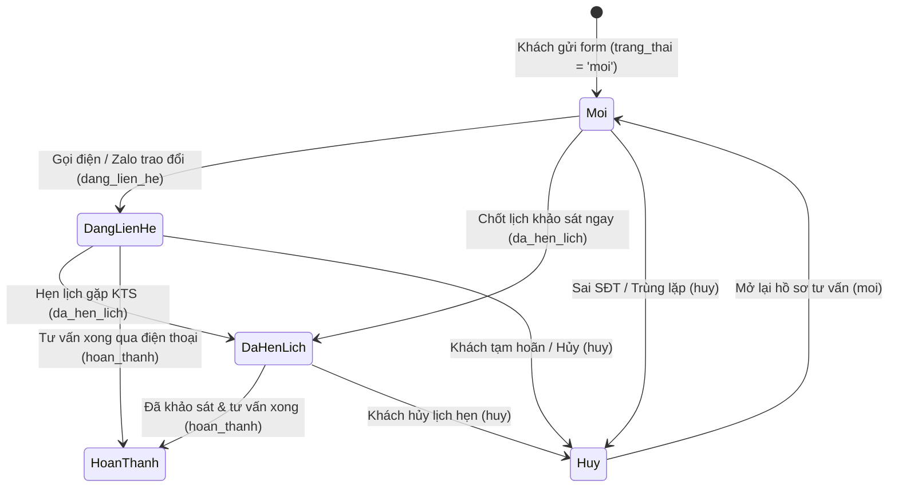

# Domain: Tiếp nhận & Quản trị Yêu cầu Tư vấn Khách hàng — Nếp Hiên (`nephien.com`)

> **Trạng thái**: Active
> **Cập nhật lần cuối**: 2026-10-20
> **Tài liệu liên quan**:
> - Thiết kế CSDL: [`docs/architecture/database-design.md`](../../architecture/database-design.md)
> - Bộ tài liệu tính năng: [`docs/specs/features/chung/yeu-cau-tu-van/`](../features/chung/yeu-cau-tu-van/)

---

## 1. Tổng quan Domain (Domain Overview)

Domain **Tiếp nhận & Quản trị Yêu cầu Tư vấn Khách hàng** (`DOM-CONSULTATION`) phụ trách toàn bộ luồng thu thập thông tin khách hàng tiềm năng (Leads) từ các biểu mẫu công khai trên website thương hiệu kiến trúc & nội thất **Nếp Hiên (`nephien.com`)** và điều phối xử lý nội bộ tại cổng quản trị Studio CMS (`/admin/articles?tab=tu_van`).

Domain giải quyết 4 bài toán cốt lõi:
1. **Không thất thoát thông tin khách hàng (Zero Lead Loss)**: Mọi lượt điền biểu mẫu từ **Form Tư vấn miễn phí trên Trang chủ (`/#contact-form`)** và **Form Đăng ký QR Ưu đãi 10% (`/uu-dai`)** đều được lưu trực tiếp, tức thời vào bảng `yeu_cau_tu_van` trên **Neon Serverless PostgreSQL** (đồng thời bắn bản sao không chặn luồng sang Formspree nếu cần nhận email phụ).
2. **Chống spam & Chuẩn hóa dữ liệu đầu vào**: Kiểm tra chặt chẽ định dạng số điện thoại di động Việt Nam (`^(\+?84|0)[35789]\d{8}$`), độ dài họ tên và bẫy bot tự động bằng trường ẩn `_gotcha` (honeypot).
3. **Điều phối & Theo dõi tiến độ tư vấn tập trung (`/admin/articles?tab=tu_van`)**: Cung cấp màn hình quản trị trực quan với 5 thẻ thống kê trạng thái (`Tất cả`, `Mới tiếp nhận`, `Đang liên hệ`, `Đã hẹn lịch KTS`, `Đã tư vấn xong`), tìm kiếm đa chiều, lọc theo nguồn đăng ký, phân công Kiến trúc sư phụ trách (`nguoi_phu_trach`) và lưu ghi chú khảo sát nội bộ (`ghi_chu_noi_bo`).
4. **Kiểm toán minh bạch (`nhat_ky_bai_viet`)**: Mọi sự kiện tiếp nhận yêu cầu mới (`yeu_cau_tu_van.tiep_nhan`), cập nhật hồ sơ (`yeu_cau_tu_van.cap_nhat`) và xóa (`yeu_cau_tu_van.xoa`) đều được ghi vết tự động vào Nhật ký hệ thống.

### Phạm vi (Scope)
* **Trong phạm vi (In-scope):**
  * Biểu mẫu công khai `ContactForm.tsx` tại `/#contact-form` (`nguon = 'form_trang_chu'`).
  * Biểu mẫu công khai `UuDaiPage` tại `/uu-dai` (`nguon = 'form_qr_uu_dai'`, kèm mã ưu đãi `NEPHIEN-QR-2026`).
  * API công khai `POST /api/v1/storefront/consultations` hỗ trợ cả payload JSON và `FormData`.
  * API quản trị `GET /api/v1/admin/consultations` và `PATCH / DELETE /api/v1/admin/consultations/[id]`.
  * Màn hình quản trị `Yêu cầu tư vấn` (`_TabTuVan.tsx`) tích hợp trong `/admin/articles?tab=tu_van` kèm số đếm trên thanh Sidebar.
* **Ngoài phạm vi (Out-of-scope):**
  * Tổng đài gọi tự động (VoIP/Auto-dialer) hoặc tự động gửi ZNS/SMS.

---

## 2. Từ vựng chung (Ubiquitous Language)

| Thuật ngữ (Tiếng Việt) | Tên kỹ thuật (Code / DB) | Định nghĩa |
| :--- | :--- | :--- |
| **Yêu cầu tư vấn** | `YeuCauTuVan` / `yeu_cau_tu_van` | Bản ghi thông tin khách hàng để lại trên website nhằm nhận tư vấn thiết kế/thi công nội thất. |
| **Nguồn đăng ký** | `NguonYeuCauTuVan` / `nguon` | Kênh xuất phát của khách hàng: `'form_trang_chu'` (`/#contact-form`), `'form_qr_uu_dai'` (`/uu-dai`), hoặc `'khac'`. |
| **Mã ưu đãi** | `maUuDai` / `ma_uu_dai` | Mã khuyến mãi gắn kèm lượt đăng ký (mặc định `'NEPHIEN-QR-2026'` khi gửi từ trang `/uu-dai`). |
| **Mới tiếp nhận** | `trang_thai = 'moi'` | Yêu cầu vừa được khách gửi lên, đang chờ tư vấn viên hoặc KTS liên hệ lần đầu. |
| **Đang liên hệ** | `trang_thai = 'dang_lien_he'` | Đội ngũ Nếp Hiên đã gọi điện/nhắn Zalo trao đổi sơ bộ nhu cầu. |
| **Đã hẹn lịch KTS** | `trang_thai = 'da_hen_lich'` | Đã chốt lịch hẹn gặp trực tiếp hoặc khảo sát hiện trạng công trình cùng Kiến trúc sư. |
| **Đã tư vấn xong** | `trang_thai = 'hoan_thanh'` | Đã hoàn tất buổi tư vấn/bàn giao phương án sơ bộ hoặc chuyển sang giai đoạn ký hợp đồng thiết kế. |
| **Không phù hợp / Hủy** | `trang_thai = 'huy'` | Số điện thoại sai, khách hủy nhu cầu hoặc thông tin trùng lặp. |
| **Ghi chú nội bộ** | `ghiChuNoiBo` / `ghi_chu_noi_bo` | Ghi chú riêng của KTS/Admin về gu thẩm mỹ, ngân sách dự kiến, lịch hẹn khảo sát của khách. |
| **Người phụ trách** | `nguoiPhuTrach` / `nguoi_phu_trach` | Tên Kiến trúc sư hoặc chuyên viên tư vấn được phân công chăm sóc khách hàng. |

---

## 3. Quy tắc nghiệp vụ cốt lõi (Business Rules & Invariants)

* **[R-TV1] Xác thực Họ tên & Số điện thoại Việt Nam bắt buộc**:
  * `ho_ten` sau khi cắt khoảng trắng phải có độ dài từ `2` đến `140` ký tự.
  * `so_dien_thoai` sau khi loại bỏ khoảng trắng và dấu phân cách (`[\s.\-()]`) phải khớp biểu thức chính quy `^(\+?84|0)[35789]\d{8}$`.
* **[R-TV2] Chống bot bằng Honeypot (`_gotcha`)**: Nếu trường ẩn `_gotcha` có giá trị khác rỗng, máy chủ trả về `201 Created` giả lập nhưng **tuyệt đối không ghi vào CSDL** để vô hiệu hóa spam bot.
* **[R-TV3] Ưu tiên hiển thị yêu cầu mới (`moi`)**: Khi truy vấn danh sách quản trị, các bản ghi có `trang_thai = 'moi'` luôn được ưu tiên xếp lên đầu (`CASE WHEN trang_thai = 'moi' THEN 0 ELSE 1 END ASC, ngay_tao DESC`) để đội ngũ không bỏ sót khách hàng mới.
* **[R-TV4] Bảo mật API quản trị**: Toàn bộ API `/api/v1/admin/consultations*` bắt buộc xác thực cookie phiên quản trị `nephien_admin_session` hợp lệ (`admin` hoặc `super_admin`).
* **[R-TV5] Ghi nhật ký kiểm toán tự động**: Mọi thao tác tiếp nhận mới, đổi trạng thái/ghi chú và xóa yêu cầu tư vấn đều ghi bản ghi tương ứng (`yeu_cau_tu_van.tiep_nhan`, `yeu_cau_tu_van.cap_nhat`, `yeu_cau_tu_van.xoa`) vào bảng `nhat_ky_bai_viet`.

---

## 4. Vòng đời trạng thái Yêu cầu tư vấn (State Machine)

