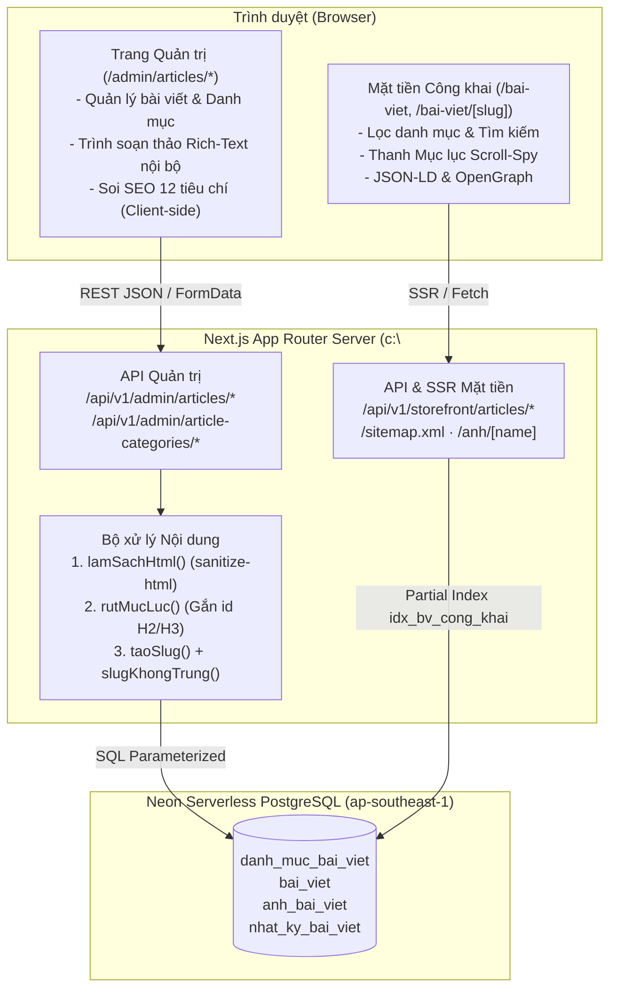

# RFC: Kiến trúc Quản lý bài viết, Bảo mật HTML & Tối ưu SEO trên Neon PostgreSQL

> **Mã tính năng**: `FEAT-BAI-VIET`
> **PRD liên quan**: [`bai-viet-prd.md`](./bai-viet-prd.md)
> **Trạng thái**: Accepted
> **Cập nhật lần cuối**: 2026-10-19

---

## 1. Bối cảnh kỹ thuật

Dự án **Nếp Hiên (`nephien.com`)** được xây dựng trên nền tảng **Next.js 14.2 App Router (TypeScript)** với hệ thống thiết kế CSS tùy chỉnh (`src/app/globals.css`) và chính sách bảo mật `Content-Security-Policy` (CSP) nghiêm ngặt trong `next.config.mjs` (`default-src 'self'`, `script-src 'self' 'unsafe-inline'`, `img-src 'self' data: blob:`).

RFC này giải quyết 5 quyết định kiến trúc quan trọng để tích hợp phân hệ Quản lý bài viết & Blog công khai vào `nephien.com` sử dụng **Neon PostgreSQL**.

---

## 2. Kiến trúc tổng thể & Luồng dữ liệu

---

## 3. Các quyết định thiết kế trọng tâm (Key Design Decisions)

### 3.1. Kết nối Neon PostgreSQL qua `postgres` (`postgres.js`)
* **Quyết định**: Sử dụng thư viện `postgres` kết nối tới chuỗi `DATABASE_URL` của Neon Pooler (`sslmode=require`), bọc trong singleton `src/lib/db.ts` để tái sử dụng kết nối giữa các lần gọi HMR trong môi trường dev và tối ưu connection pool ở production.
* **Lý do**: Nhẹ, hỗ trợ đầy đủ kiểu dữ liệu PostgreSQL (`jsonb`, `bytea`, `timestamptz`, `bigint`), cú pháp tagged template literals `sql` tự động parameterize mọi biến đầu vào, loại bỏ hoàn toàn nguy cơ SQL Injection.

### 3.2. Làm sạch HTML & Trích xuất mục lục lúc lưu (Write-time Sanitization & TOC Extraction)
* **Quyết định**: Mọi nội dung `noi_dung_html` gửi lên từ trình soạn thảo đều được xử lý qua 2 bước trên server trước khi ghi vào bảng `bai_viet`:
  1. `lamSachHtml(rawHtml)`: Dùng `sanitize-html` với allowlist thẻ (`h2, h3, h4, p, br, hr, strong, b, em, i, u, s, ul, ol, li, blockquote, a, span, div, table, thead, tbody, tr, th, td, img, figure, figcaption`). Loại bỏ toàn bộ `script`, `style`, `iframe`, `object`, `on*` event handlers, và kiểm tra `img[src]` chỉ nhận đường dẫn nội bộ `/anh/...` hoặc `/images/...`.
  2. `rutMucLuc(cleanHtml)`: Duyệt các thẻ `<h2>` và `<h3>`, sinh `id` dạng slug ASCII không trùng (`#muc-1`, `#chon-vat-lieu-go`...), bơm thuộc tính `id="..."` vào thẻ và xuất mảng `muc_luc: [{ id, chu, bac }]` lưu vào cột `jsonb`.
* **Lý do**:
  * Chặn đứng Stored XSS ngay tại cổng ghi dữ liệu.
  * Trang đọc bài `/bai-viet/[slug]` chỉ cần render trực tiếp `noi_dung_html` và `muc_luc` đã chuẩn bị sẵn, giảm thời gian tải trang (TTFB) xuống mức tối thiểu.

### 3.3. Trình soạn thảo Rich-Text tự chủ (Zero External CDN Dependency)
* **Quyết định**: Xây dựng trình soạn thảo WYSIWYG trực quan ngay trong dự án (hỗ trợ đầy đủ thanh công cụ H2, H3, H4, Đậm, Nghiêng, Gạch chân, Danh sách, Trích dẫn, Bảng, Liên kết, Chèn ảnh tải lên trực tiếp, Chế độ xem mã HTML và Xem trước bài viết) thay vì nhúng script CDN bên thứ ba.
* **Lý do**: `next.config.mjs` của `nephien.com` áp dụng chính sách `Content-Security-Policy: default-src 'self'`. Trình soạn thảo nội bộ đảm bảo tương thích 100% với CSP, không bao giờ lỗi tải script mạng và đồng bộ hoàn hảo với bảng màu/font chữ của Nếp Hiên.

### 3.4. Lưu trữ ảnh tải lên trong bảng `anh_bai_viet` (Neon DB) kết hợp route `/anh/[name]`
* **Quyết định**: Khi quản trị viên tải ảnh bìa hoặc ảnh trong bài viết lên qua `/api/v1/admin/articles/images`, server kiểm tra magic bytes (PNG, JPEG, WEBP, GIF, tối đa 5MB), lưu dữ liệu nhị phân (`bytea`) vào bảng `anh_bai_viet` trên Neon DB và trả về đường dẫn `/anh/{ten_file}`. Route `/anh/[name]/route.ts` đọc từ DB (hoặc bộ nhớ đệm) và trả ảnh kèm `Cache-Control: public, max-age=31536000, immutable`.
* **Lý do**: Đảm bảo ảnh tải lên được lưu trữ bền vững trong chính Neon PostgreSQL mà người dùng cung cấp, không phụ thuộc S3/R2 bên ngoài và tương thích với quy tắc CSP `img-src 'self'` cũng như bộ lọc `lamSachHtml` (chỉ nhận `/anh/...` và `/images/...`).

### 3.5. Soi SEO 12 tiêu chí chạy hoàn toàn phía Client (`src/lib/seo-bai-viet.ts`)
* **Quyết định**: Toàn bộ hàm `chamSeo()` tính toán 12 tiêu chí SEO On-Page chạy trực tiếp trên trình duyệt theo từng nhịp gõ (không gọi API máy chủ) và không chặn nút **Lưu** hay **Đăng bài**.
* **Lý do**: Phản hồi tức thì (0ms latency), biên tập viên thấy ngay tiêu chí nào chuyển sang màu xanh khi vừa gõ thêm từ khóa hoặc thẻ H2, đồng thời vẫn giữ quyền quyết định cuối cùng cho người viết (với các bài chính sách ngắn không cần tối ưu từ khóa).
