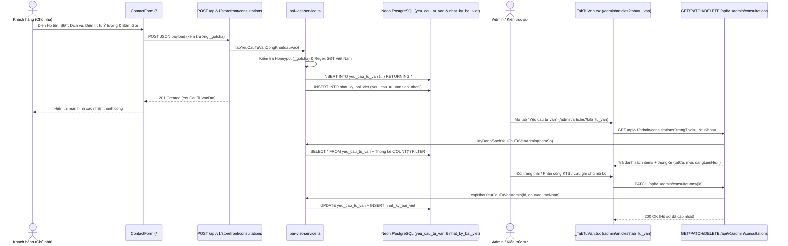

# RFC: Thiết kế Kiến trúc Tiếp nhận & Quản trị Yêu cầu Tư vấn — Nếp Hiên (`nephien.com`)

> **Mã tính năng**: `FEAT-YEU-CAU-TU-VAN`
> **PRD tham chiếu**: [`yeu-cau-tu-van-prd.md`](./yeu-cau-tu-van-prd.md)
> **Trạng thái**: Approved
> **Cập nhật lần cuối**: 2026-10-20

---

## 1. Kiến trúc tổng thể (System Architecture)

Luồng dữ liệu từ biểu mẫu mặt tiền (`/#contact-form` và `/uu-dai`) vào cơ sở dữ liệu **Neon Serverless PostgreSQL** và hiển thị trên màn hình quản trị **Studio CMS (`/admin/articles?tab=tu_van`)** được thiết kế theo mô hình tuần tự dưới đây:

---

## 2. Quyết định Kỹ thuật Trọng yếu (Key Design Decisions)

### 2.1. Hợp nhất 2 biểu mẫu công khai vào 1 bảng chuẩn hóa `yeu_cau_tu_van`
* **Lý do**: Website có 2 biểu mẫu thu thập khách hàng tiềm năng:
  1. `ContactForm.tsx` (`/#contact-form`): Thu thập `name` (`ho_ten`), `phone` (`so_dien_thoai`), `service` (`dich_vu`), `area` (`dien_tich`), `message` (`loi_nhan`).
  2. `UuDaiPage` (`/uu-dai`): Thu thập `owner_name` (`ho_ten`), `phone` (`so_dien_thoai`), `email`, `nhu_cau` (ánh xạ vào `dich_vu`), `ma_can` (ánh xạ vào `dien_tich`), `note` (ánh xạ vào `loi_nhan`) và mã ưu đãi `NEPHIEN-QR-2026` (`ma_uu_dai`).
* **Giải pháp**: Lưu chung vào bảng `yeu_cau_tu_van`, phân biệt bằng cột `nguon` (`'form_trang_chu'` hoặc `'form_qr_uu_dai'`) và cột `ma_uu_dai`. Nhờ vậy, đội ngũ CSKH & KTS quản lý toàn bộ khách hàng trên 1 màn hình duy nhất nhưng vẫn lọc riêng được khách đến từ chiến dịch QR Ưu đãi.

### 2.2. Dual-Write thông minh: Ưu tiên Neon PostgreSQL + Gửi phụ sang Formspree
* Khi khách hàng nhấn gửi form, trình duyệt gọi đồng thời:
  * **Luồng chính (`await fetch('/api/v1/storefront/consultations')`)**: Lưu bền vững vào Neon PostgreSQL và ghi nhật ký hệ thống.
  * **Luồng phụ không chặn (`fetch('https://formspree.io/f/mdavqbdv').catch(() => {})`)**: Duy trì thông báo email qua Formspree nếu có cấu hình mà không làm chậm hay gây lỗi trải nghiệm của khách hàng.

### 2.3. Tự động khởi tạo bảng & dữ liệu mẫu an toàn (`damBaoBangYeuCauTuVan`)
* Để hệ thống hoạt động tức thì trên mọi môi trường Neon PostgreSQL mà không cần chạy script thủ công, hàm `damBaoBangYeuCauTuVan()` trong `src/lib/content/bai-viet-service.ts` thực thi `CREATE TABLE IF NOT EXISTS yeu_cau_tu_van` và `CREATE INDEX IF NOT EXISTS idx_yctv_quan_tri` ở lần truy cập đầu tiên trong vòng đời tiến trình.
